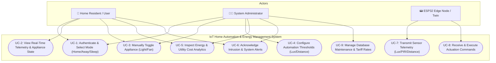
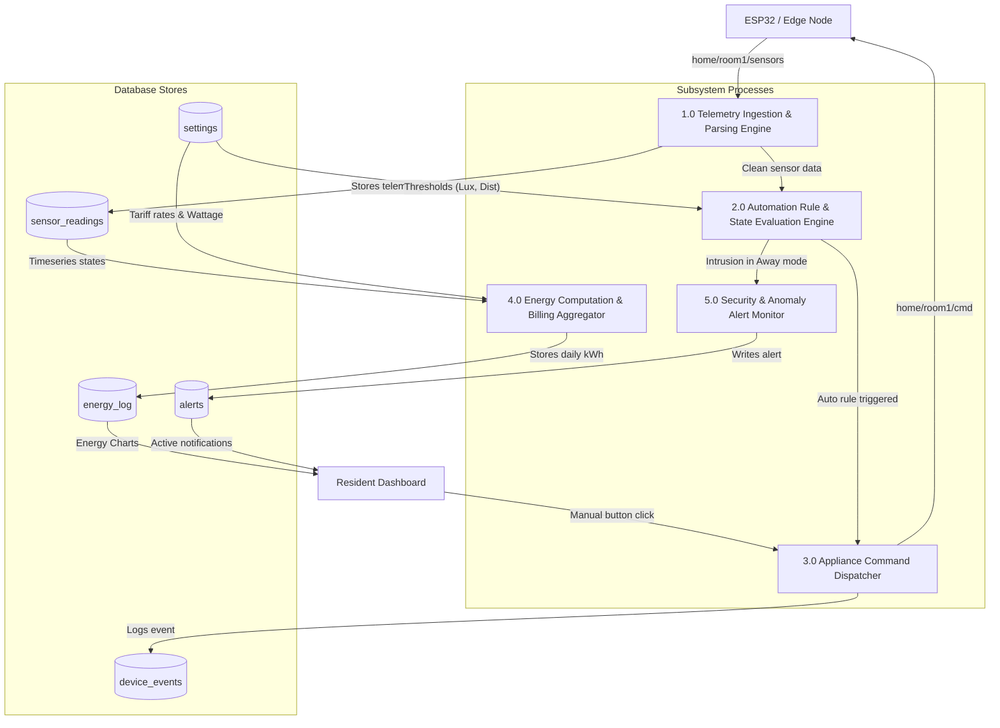
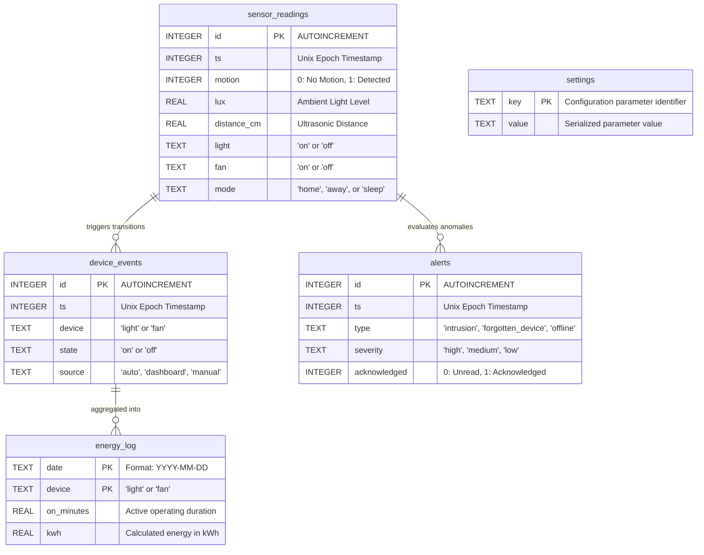
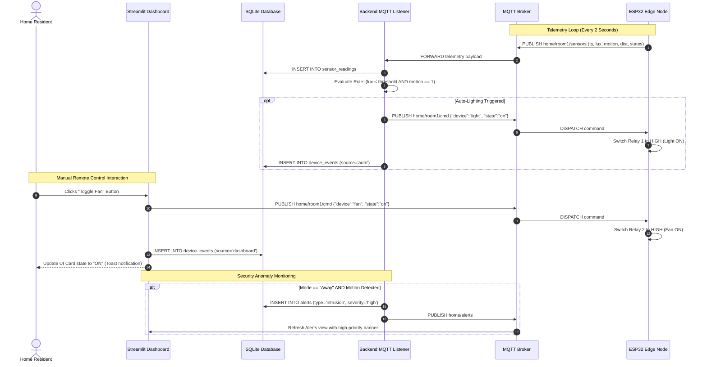

# SOFTWARE REQUIREMENTS SPECIFICATION (SRS)
## IoT Smart Home Automation & Energy Management System
**Standard Academic Compliance:** IEEE Std 830-1998  
**Document Code:** SRS-CSE-IOT-2026-01  

---

### **DEPARTMENT OF COMPUTER SCIENCE AND ENGINEERING**
**Affiliation:** Dr. A.P.J. Abdul Kalam Technical University (AKTU), Lucknow  

---

| **Project Title** | **IoT Smart Home Automation & Energy Management System** |
| :--- | :--- |
| **Academic Standard** | IEEE Std 830-1998 Recommended Practice for SRS |
| **Academic Year** | 2026 – 2027 |
| **Academic Degree** | Bachelor of Technology (B.Tech) in Computer Science and Engineering |
| **Status** | 3rd Year Mid-Term Project Specification Baseline |
| **Date of Submission** | 01-October-2026 |

<br>

| **SUBMITTED BY:** | **UNDER THE GUIDANCE OF:** |
| :--- | :--- |
| **PARTH MISHRA** <br> University Roll No: **2400320100789** <br> Department of Computer Science & Engineering | **Ms. ANUPAM** <br> Assistant Professor <br> Department of Computer Science & Engineering |

---
---

## Document Revision & Approval History

| Version | Date | Description / Major Changes | Prepared By | Reviewed By |
| :--- | :--- | :--- | :--- | :--- |
| **0.1** | 15-Sep-2026 | Initial Draft, Feasibility Analysis & Scope Definition | Parth Mishra | Ms. Anupam |
| **0.5** | 24-Sep-2026 | Sensor Telemetry Schema, MQTT Broker Contract & UI Layout | Parth Mishra | Ms. Anupam |
| **1.0** | 30-Sep-2026 | Final 3rd Year Mid-Term SRS Baseline & IEEE 830 Conformance | Parth Mishra | Project Evaluation Committee / HOD |

> **Guidance Note:** This Software Requirements Specification (SRS) document strictly complies with the IEEE 830-1998 recommended standard format. All sections, requirements matrices, external interfaces, non-functional metrics, and architectural analysis diagrams are tailored for 3rd-year undergraduate university evaluation, technical defense, and project development baselines.

---

## 1. Introduction

### 1.1 Purpose
The purpose of this Software Requirements Specification (SRS) document is to provide a complete, clear, rigorous, and verifiable definition of the functional capabilities, external interfaces, operational constraints, hardware interactions, and performance targets of the **IoT Smart Home Automation & Energy Management System**. 

This document serves as the formal contractual and design baseline between student developer **Parth Mishra**, project guide **Ms. Anupam**, department evaluators, and prospective end users throughout the system design and implementation phases of the 3rd-year engineering curriculum.

### 1.2 Scope of the System
The proposed system addresses the inefficiencies, safety vulnerabilities, and excessive energy consumption common in modern households caused by uncoordinated manual appliance switching, lack of environmental awareness, and absence of granular power telemetry. The application delivers an automated, edge-to-cloud smart home ecosystem integrating physical microcontrollers (ESP32), an asynchronous MQTT messaging broker, persistent local storage, and an interactive, real-time analytics web dashboard.

* **In-Scope Capabilities:**
  * **Edge Telemetry Acquisition:** Continuous sensing of ambient light (Lux), physical motion (PIR), and room occupancy/proximity (Ultrasonic distance) via ESP32 nodes and simulated twin drivers.
  * **Intelligent Appliance Actuation:** Automated rule evaluation (e.g., auto-lighting on low ambient illumination and occupancy, auto-fan regulation based on proximity distance) as well as sub-second manual dashboard switching.
  * **System Security & Mode Governance:** Multi-mode home operation (`Home`, `Away`, `Sleep`) with real-time intrusion alerting when unexpected movement occurs in restricted modes.
  * **Energy Analytics & Financial Tracking:** Automated computation of appliance on-time durations, cumulative kilowatt-hour (kWh) power consumption, and monthly electricity billing forecasts.
  * **Historical Auditing & Alert Notification:** Local SQLite persistence with indexed timeseries queries and alert acknowledgement workflows.

* **Out-of-Scope Boundaries:**
  * Industrial high-voltage three-phase machinery interfacing (limited to standard domestic AC/DC appliance relay switching).
  * Third-party paid commercial SMS gateways (notifications handled through on-dashboard toast alerts, persistent alert event feeds, and optional webhooks).
  * Direct payment gateway settlements for energy bills (computations provide utility estimates; no live banking APIs involved).

* **Expected Benefits:**
  * Up to **30–40% reduction** in redundant domestic power consumption through automatic presence-based appliance cutoff.
  * Instantaneous (< 500 ms) remote situational awareness of home environment and appliance states.
  * Elimination of manual logging through automated daily energy rollups and SQLite timeseries recording.

### 1.3 Definitions, Acronyms, and Abbreviations

| Category | Term / Acronym | Definition / Standard Context |
| :--- | :--- | :--- |
| **Standard** | **SRS** | Software Requirements Specification (IEEE Std 830-1998 format). |
| **Hardware** | **ESP32** | Low-cost, low-power system on a chip (SoC) microcontroller with integrated Wi-Fi and dual-mode Bluetooth by Espressif Systems. |
| **Hardware** | **PIR** | Passive Infrared Sensor (e.g., HC-SR501) used to detect human body motion via infrared radiation changes. |
| **Hardware** | **LDR** | Light Dependent Resistor used for measuring ambient environmental luminosity (Lux). |
| **Hardware** | **GPIO** | General-Purpose Input/Output pins on the microcontroller for digital/analog signal interfacing. |
| **Protocol** | **MQTT** | Message Queuing Telemetry Transport; lightweight publish/subscribe ISO standard (ISO/IEC 20922) messaging protocol designed for constrained networks. |
| **Network** | **QoS** | Quality of Service; MQTT delivery guarantee level (QoS 0: At most once, QoS 1: At least once, QoS 2: Exactly once). |
| **Architecture** | **API** | Application Programming Interface for structured programmatic data exchange. |
| **Security** | **RBAC** | Role-Based Access Control restricting system operations based on assigned user persona privileges. |
| **Database** | **CRUD** | Create, Read, Update, and Delete database operations. |
| **Database** | **WAL** | Write-Ahead Logging; SQLite concurrency mechanism providing high read/write performance. |
| **Frontend** | **Streamlit** | Python-based reactive web application framework for building data science and real-time operational dashboards. |

### 1.4 References
1. **IEEE Std 830-1998:** *IEEE Recommended Practice for Software Requirements Specifications*, IEEE Computer Society, 1998.
2. **Software Engineering (10th Edition):** Ian Sommerville, Pearson Education, 2016.
3. **MQTT Version 3.1.1 Plus Errata 01:** OASIS Standard, Edited by Andrew Banks and Rahul Gupta, 2015.
4. **Espressif Systems:** *ESP32 Series Datasheet & Technical Reference Manual v4.7*, Espressif Inc., 2023.
5. **Eclipse Paho:** *Paho Python MQTT Client Documentation*, Eclipse Foundation (`paho-mqtt`).
6. **SQLite Architecture Documentation:** D. Richard Hipp et al., *SQLite Database Engine Design and Concurrency Model*, 2024.

### 1.5 Document Overview
The remainder of this SRS document is structured as follows:
* **Section 2 (Overall Description):** Presents the product perspective, architectural context, user classes, target operational environment, implementation constraints, and fundamental assumptions.
* **Section 3 (Specific System Features and Functional Requirements):** Details the functional modules (Authentication & Mode Governance, Telemetry Ingestion & Actuation, Energy Analytics & Alerting) using tabular requirement specifications (FR-x.x).
* **Section 4 (External Interface Requirements):** Details User Interfaces (UI), Hardware Interfaces, Software Libraries, and Communication Protocol payload structures.
* **Section 5 (Non-Functional Requirements):** Formulates verifiable engineering benchmarks for Performance, Security, Reliability, and Portability.
* **Section 6 (System Design and Analysis Models):** Contains UML and academic models including Use Case Diagrams, DFD Level 0 & Level 1, Entity-Relationship Diagram (ERD), and Sequence Diagrams.
* **Section 7 (Academic Review & Sign-Off):** Formal evaluation panel sign-off sheet for guide and examiners.

---

## 2. Overall Description

### 2.1 Product Perspective
The **IoT Smart Home Automation & Energy Management System** operates as a distributed, decoupled, multi-tier cyber-physical system. Unlike monolithic or tight-coupled hardware controllers, this system decouples physical edge nodes, asynchronous messaging, persistent timeseries logging, and dynamic user interfaces.

```
+---------------------------------------------------------------------------------------+
|                                    PHYSICAL / EDGE TIER                                |
|  +--------------------------------+                  +------------------------------+ |
|  | Physical ESP32 Hardware Node   |                  | Virtual Python Edge Twin     | |
|  | (LDR, PIR, Ultrasonic, Relays) |                  | (simulator/esp32_sim.py)     | |
|  +---------------+----------------+                  +--------------+---------------+ |
+------------------|--------------------------------------------------|-----------------+
                   |                                                  |
                   | MQTT (home/room1/sensors)                        | MQTT
                   +------------------------+-------------------------+
                                            |
                                            v
+---------------------------------------------------------------------------------------+
|                                 MESSAGING BROKER TIER                                 |
|                       Cloud / Local MQTT Broker (HiveMQ / Mosquitto)                  |
|                        Topics: home/room1/sensors | home/room1/cmd | home/alerts      |
+-------------------------------------------+-------------------------------------------+
                                            |
                         +------------------+------------------+
                         |                                     |
                         v                                     v
+-----------------------------------------------+ +-------------------------------------+
|            APPLICATION / DAEMON TIER          | |          PRESENTATION TIER          |
|  MQTT Listener & Rule Engine                  | |  Streamlit Dashboard                |
|  (backend/mqtt_listener.py)                   | |  (dashboard/app.py & subpages)      |
|  - Telemetry consumer                         | |  - Live appliance control cards     |
|  - Anomaly & intrusion evaluator              | |  - Energy billing analytics         |
|  - Forgotten-device timer engine              | |  - Alert management & thresholds    |
+-----------------------+-----------------------+ +------------------+------------------+
                        |                                            |
                        | Writes Telemetry & Events                  | Reads & Aggregates
                        v                                            v
+---------------------------------------------------------------------------------------+
|                                   PERSISTENCE TIER                                    |
|                       Relational Timeseries Database: SQLite3                         |
|    (Tables: sensor_readings, device_events, alerts, energy_log, settings)             |
+---------------------------------------------------------------------------------------+
```

### 2.2 User Classes and Characteristics

| User Role / Persona | Technical Proficiency | Core Responsibilities & Access Rights |
| :--- | :--- | :--- |
| **System Administrator / Engineer** | **High** (IoT / Embedded / Python) | Complete system privileges: calibrating MQTT broker endpoints, defining hardware GPIO pinouts, adjusting electricity tariff multipliers, modifying sensor thresholds, managing database migrations, and inspecting raw message logs. |
| **Home Resident / Primary User** | **Intermediate** (General Web User) | Operational privileges: viewing real-time environmental telemetry, toggling appliance actuators (Lights, Fans), switching operational system modes (`Home`, `Away`, `Sleep`), inspecting energy consumption charts, and acknowledging intrusion alerts. |
| **Guest / Household Occupant** | **Basic** | Limited privileges: viewing localized room status (temperature/lux/motion) and manual switching of assigned room appliances with restricted access to global configuration, tariff settings, and system security logs. |

### 2.3 Operating Environment
The software and hardware system functions across the following environments:
* **Client Requirements:**
  * Modern Web Browsers: Google Chrome (>= v110), Mozilla Firefox (>= v108), Microsoft Edge (>= v110), Apple Safari (>= v16).
  * Display Resolutions: Desktop/Laptop (1366x768 up to 4K UHD), Tablet (768x1024), Mobile responsive view (down to 360x640).
* **Server Runtime Environment:**
  * OS: Microsoft Windows 10/11, Ubuntu Linux 22.04 LTS, or Debian 12.
  * Execution Environment: Python 3.10+ runtime, Streamlit 1.30+, Paho-MQTT 1.6+/2.0+.
* **Database Storage Tier:**
  * Embedded SQLite 3.38+ with WAL (Write-Ahead Logging) enabled for non-blocking concurrent reads and writes.
* **IoT Edge Hardware Environment:**
  * Microcontroller: Espressif ESP32-WROOM-32 (Dual Core 240 MHz, 520 KB SRAM, 4 MB Flash).
  * Power Supply: 5V DC via micro-USB / external 5V 2A regulated power adapter.
  * Sensor Peripherals: HC-SR501 PIR Motion Sensor, LDR Ambient Light Sensor module with analog output, HC-SR04 Ultrasonic Distance Sensor, 5V Dual-Channel Relay Optocoupler Module.

### 2.4 Design and Implementation Constraints
* **Academic Budget Constraint:** The system is designed to run entirely on zero-cost, open-source software libraries, utilizing public broker clusters (e.g., HiveMQ public broker `broker.hivemq.com` or local Eclipse Mosquitto) and local embedded database engines without requiring costly cloud subscriptions.
* **Network & Concurrency Constraints:** Real-world home Wi-Fi networks exhibit intermittent drops. Edge firmware and backend listener scripts must implement non-blocking connection threads with automatic reconnection routines.
* **Hardware Electrical Isolation:** Microcontroller 3.3V logic pins interface with high-draw 5V relays through optocouplers to prevent back-EMF damage to the ESP32 core.
* **Stateless UI Design:** The presentation tier must decouple state persistence to SQLite rather than memory sessions, guaranteeing that multiple dashboard instances or page reloads preserve consistent device states.

### 2.5 Assumptions and Dependencies
* **Assumptions:**
  * The edge hardware node and server/host computer maintain uninterrupted connectivity to an active local network or internet access point with minimal bandwidth of 512 Kbps.
  * Edge sensor sensors operate within nominal domestic ambient temperature (-10°C to +50°C).
* **Dependencies:**
  * Uninterrupted operational availability of the MQTT broker cluster over TCP Port 1883.
  * Accuracy of the system local clock synchronized via NTP (Network Time Protocol) for millisecond-level telemetry timestamping.

---

## 3. System Features and Functional Requirements

Functional requirements are partitioned into three dedicated subsystem modules with unique, traceable requirement identifiers (**FR-x.x**).

### 3.1 Module 1: System Mode Governance & Access Control

| Req ID | Feature Description | Input / Validation Rule | Priority |
| :--- | :--- | :--- | :--- |
| **FR-1.1** | **System Operating Mode Switcher** | Accepts one of three predefined operational states: `Home`, `Away`, or `Sleep`. Commands validated against enumeration. | **High** |
| **FR-1.2** | **Mode-Based Behavior Propagation** | Upon mode selection, updates state in database and publishes MQTT broadcast payload `{"device": "mode", "state": "<value>"}` to `home/room1/cmd`. | **High** |
| **FR-1.3** | **Security Guard Enforcement (`Away` Mode)** | When mode is set to `Away`, any motion detected by the PIR sensor automatically triggers an immediate high-severity intrusion alert. | **High** |
| **FR-1.4** | **Power Conservation Policy (`Sleep` Mode)** | When mode transitions to `Sleep`, non-essential ambient appliances (e.g. decorative lights, high-draw fans) receive automated turn-off commands unless overridden manually. | **Medium** |
| **FR-1.5** | **Device Session & Online State Tracker** | Background listener detects heartbeat silence (> 10 seconds without telemetry) and updates edge connectivity status to `Offline`. | **Medium** |

### 3.2 Module 2: IoT Telemetry Ingestion, Appliance Actuation & Rule Engine

| Req ID | Feature Description | Input / Validation Rule | Priority |
| :--- | :--- | :--- | :--- |
| **FR-2.1** | **Continuous Telemetry Ingestion** | Subscribes to `home/room1/sensors`; parses JSON payloads containing `ts` (Unix integer), `motion` (boolean/int), `lux` (float >= 0.0), `distance_cm` (float >= 0.0), `light` ("on"/"off"), `fan` ("on"/"off"). | **High** |
| **FR-2.2** | **Manual Appliance Actuation** | User toggles UI button for Light or Fan; dispatches instantaneous JSON command to `home/room1/cmd` (`{"device": "light"\|"fan", "state": "on"\|"off"}`) within < 200ms. | **High** |
| **FR-2.3** | **Intelligent Light Automation** | If `auto_light` mode is enabled, evaluates ambient Lux against calibrated threshold: turns light `on` when `lux < threshold` AND `motion == True`; turns light `off` after configured inactivity timeout. | **High** |
| **FR-2.4** | **Intelligent Fan Automation** | If `auto_fan` mode is enabled, evaluates proximity distance: turns fan `on` when `distance_cm <= threshold` (presence at desk/bed); turns fan `off` when occupancy distance exceeds threshold. | **Medium** |
| **FR-2.5** | **Appliance Event Logging** | Every state transition logs a record to `device_events` recording timestamp, device name, new state, and trigger source (`auto`, `dashboard`, `manual`). | **High** |
| **FR-2.6** | **Dual Edge Architecture (Twin Simulation & ESP32)** | System seamlessly switches between simulated twin (`esp32_sim.py`) and real ESP32 microcontroller with identical MQTT contract and zero dashboard modifications. | **High** |

### 3.3 Module 3: Energy Consumption Analytics, Alert Monitoring & Dynamic Configuration

| Req ID | Feature Description | Input / Validation Rule | Priority |
| :--- | :--- | :--- | :--- |
| **FR-3.1** | **Live Energy Accumulation & Costing** | Calculates cumulative on-time minutes for each device; computes active kilowatt-hours: `kWh = (Wattage * on_minutes) / (60 * 1000)`; applies configurable electricity tariff rate per kWh. | **High** |
| **FR-3.2** | **Historical Day-by-Day Energy Breakdown** | Aggregates daily energy metrics from `energy_log` into bar charts, device usage pie charts, and tabular weekly audit reports. | **Medium** |
| **FR-3.3** | **Security & System Alert Generation** | Evaluates triggers: (a) `intrusion` (motion during `Away`), (b) `forgotten_device` (appliance left ON for > configured hours with zero motion), (c) `offline` (broker timeout). Logs to `alerts` table. | **High** |
| **FR-3.4** | **Interactive Alert Triage & Acknowledgment** | Dashboard displays active alert feed with visual severity indicators (High/Red, Medium/Orange, Low/Yellow) and allows user to mark alerts as `Acknowledged`. | **Medium** |
| **FR-3.5** | **Dynamic System Calibration (Settings Engine)** | Provides user controls to adjust: Lux threshold (0–1000 Lux), Distance threshold (10–200 cm), Electricity tariff rate ($/₹ per kWh), Light wattage (W), Fan wattage (W). Updates `settings` key-value table. | **Medium** |

---

## 4. External Interface Requirements

### 4.1 User Interfaces (UI)
The presentation tier is implemented via an interactive, modern dashboard designed according to responsive usability principles:
* **Live Status & Control View (`dashboard/app.py`):**
  * **Header Ribbon:** Displays connection heartbeat, current active system mode badge, and quick emergency cutoff switch.
  * **Appliance Control Cards:** Glassmorphic status cards for `Main Light` and `Room Fan` with state indicators (`ON` / `OFF`), manual toggle switches, and quick mode overrides.
  * **Environmental Sensor Metrics:** Visual gauge cards showing ambient Lux, ultrasonic distance in centimeters, and PIR motion state.
  * **System Mode Radio/Selector:** Instantaneous selector between `Home`, `Away`, and `Sleep`.
* **Energy Analytics View (`dashboard/pages/1_Energy.py`):**
  * Metric summary cards for Total Consumption (kWh), Estimated Total Cost, and Active Load Wattage.
  * Interactive 7-day bar chart showing daily consumption trends.
  * Appliance breakdown donut/pie chart comparing Light vs. Fan power usage.
* **Alerts & Diagnostics Console (`dashboard/pages/2_Alerts.py`):**
  * Real-time notification list with timestamp, alert category, and one-click "Acknowledge" action button.
* **Configuration & Calibration Panel (`dashboard/pages/3_Settings.py`):**
  * Numerical input steppers and sliders for environmental thresholds and energy tariff parameters.

### 4.2 Hardware Interfaces
* **Microcontroller Node (ESP32):**
  * Operating Voltage: 3.3V logic (powered via 5V VIN rail).
  * Flash memory: 4MB SPI Flash; Wi-Fi: 802.11 b/g/n (2.4 GHz).
* **Sensors and Actuators Pin Assignment Schema:**

| Component | Interface Type | Microcontroller Pin (ESP32) | Operating Parameter |
| :--- | :--- | :--- | :--- |
| **HC-SR501 PIR Sensor** | Digital Input | **GPIO 13** | High (3.3V) on motion detected; Low (0V) quiescent. |
| **LDR Light Sensor Module** | Analog Input (ADC1) | **GPIO 34** (ADC1_CH6) | 12-bit ADC (0 to 4095 mapped to 0–1000 Lux). |
| **HC-SR04 Trigger** | Digital Output | **GPIO 5** | 10 microsecond trigger pulse. |
| **HC-SR04 Echo** | Digital Input (Voltage Divided) | **GPIO 18** | High pulse duration proportional to distance (2cm–400cm). |
| **Relay Channel 1 (Light)** | Digital Output | **GPIO 22** | Active Low / High depending on relay module trigger logic. |
| **Relay Channel 2 (Fan)** | Digital Output | **GPIO 23** | Active Low / High switching 5V/220V appliance loads. |
| **Status LED Indicator** | Digital Output | **GPIO 2** (On-board LED) | Blinks on Wi-Fi/MQTT publish; solid on active connection. |

### 4.3 Software Interfaces
* **Database Management System:** SQLite 3 utilizing Python's built-in `sqlite3` driver with foreign key constraints and `check_same_thread=False` concurrency handling.
* **Messaging Client:** Eclipse Paho MQTT (`paho-mqtt`) Python client supporting callback loops (`loop_start()` / `loop_stop()`) for non-blocking asynchronous message consumption.
* **Dashboard Framework:** Streamlit engine with native Pandas data manipulation and Altair/Plotly interactive visualization libraries.

### 4.4 Communication Interfaces
* **Network Protocol:** MQTT (Message Queuing Telemetry Transport) v3.1.1 running over TCP/IP.
  * Standard Port: `1883` (Plain TCP) or `8883` (TLS Encrypted).
  * WebSockets Port: `8083` / `8884` (for browser-native telemetry).
* **Data Serialization Format:** Lightweight UTF-8 encoded JSON (JavaScript Object Notation).

#### Telemetry Payload Specification (`home/room1/sensors`):
```json
{
  "ts": 1727780000,
  "motion": 1,
  "lux": 184.2,
  "distance_cm": 65.5,
  "light": "on",
  "fan": "off",
  "mode": "home"
}
```

#### Command Payload Specification (`home/room1/cmd`):
```json
{
  "device": "light",
  "state": "on"
}
```

#### Alert Notification Payload Specification (`home/alerts`):
```json
{
  "type": "intrusion",
  "severity": "high",
  "ts": 1727780050
}
```

---

## 5. Non-Functional Requirements (NFRs)

| Attribute | Target Metric / Benchmark | Verification & Testing Method |
| :--- | :--- | :--- |
| **5.1 Performance** | • Sensor publish to database latency: **< 250 ms**.<br>• Dashboard command to relay trigger latency: **< 500 ms**.<br>• Dashboard initial page load time: **< 2.0 s**.<br>• Time-series query execution (7-day energy data): **< 100 ms**. | End-to-end timestamp benchmarking; Apache Bench / Locust synthetic load script. |
| **5.2 Security** | • Zero hardcoded credentials in source control (isolated in `.env`).<br>• SQL injection mitigation via parameterized database queries.<br>• Secure topic namespacing with device-level authorization.<br>• Protected dashboard access via environment tokens. | Static code analysis (Bandit); OWASP ZAP automated vulnerability scan. |
| **5.3 Reliability & Availability** | • System availability: **>= 99.0%** uptime during evaluation.<br>• Automatic MQTT reconnect with exponential backoff on network drop.<br>• Persistent database transaction atomicity with zero data corruption upon unexpected power failure. | Continuous 48-hour soak testing; intentional Wi-Fi router disconnect recovery simulation. |
| **5.4 Portability & Maintainability** | • Clean modular codebase separating UI, business logic, DB access, and hardware drivers.<br>• Platform agnostic: executes identically on Windows, Linux, and macOS.<br>• Edge compatibility: runs on real physical ESP32 or software emulator with zero frontend code changes. | Cross-platform runtime validation across Windows 11 and Ubuntu 22.04 LTS environments. |

---

## 6. System Design and Analysis Models

### 6.1 Architectural Analysis Deliverables Summary

| Diagram Type | Objective & Scope | Deliverable Format |
| :--- | :--- | :--- |
| **Use Case Diagram** | Maps user actors (Resident, Admin, Hardware Edge Node) to core system capabilities. | UML standard diagram with actor boundary specifications. |
| **Data Flow Diagram (Level 0 Context)** | Illustrates the top-level external entity boundaries and core system data flow. | Gane-Sarson / Yourdon structured analysis model. |
| **Data Flow Diagram (Level 1 Functional)** | Decomposes system into sub-processes: Ingestion, Control, Analytics, and Alerting. | Hierarchical functional decomposition diagram. |
| **Entity-Relationship Diagram (ERD)** | Specifies relational database entities, primary keys, foreign constraints, and cardinality. | Crow's Foot notation schema with 3NF relational normalization. |
| **Sequence Diagram** | Visualizes chronological message exchanges during telemetry capture, automated rule evaluation, and user actuation. | UML Sequence diagram detailing asynchronous event flows. |

---

### 6.2 Use Case Diagram



---

### 6.3 Data Flow Diagrams (DFD)

#### Level 0: Context Diagram
```mermaid
flowchart LR
    EdgeNode["ESP32 Microcontroller / Sensor Node"]
    System["[0.0] IoT Smart Home Automation & Energy Management System"]
    Resident["Home Resident / Admin User"]
    DB[("SQLite Persistent Storage")]

    EdgeNode -- "Raw Telemetry (Lux, Motion, Distance, States) via MQTT" --> System
    System -- "Relay Switching Commands (Light, Fan) via MQTT" --> EdgeNode

    Resident -- "Manual Control & Mode Switch (Home/Away/Sleep)" --> System
    Resident -- "Threshold & Tariff Settings" --> System
    System -- "Visual Telemetry, Energy Analytics & Alert Notifications" --> Resident

    System <--> "Read / Write Historical Records" DB
```

#### Level 1: Functional Decomposition Diagram


---

### 6.4 Entity-Relationship Diagram (ERD)



---

### 6.5 Sequence Diagram: Real-Time Telemetry, Automation & Manual Actuation



---

## 7. Academic Review & Sign-Off

This Software Requirements Specification (SRS) document for the project titled **"IoT Smart Home Automation & Energy Management System"** submitted by **Parth Mishra** (Roll No: **2400320100789**) has been formally reviewed, vetted, and approved by the academic supervisory committee for fulfillment of the 3rd-year engineering curriculum milestone.

<br><br>

```
__________________________________            __________________________________            __________________________________
Signature: Ms. Anupam                         Signature: Internal Examiner                  Signature: Head of Department
Project Guide / Assistant Professor           Department of Computer Science                Department of Computer Science
Department of Computer Science & Engg.        and Engineering                               and Engineering
Date: ___________________________             Date: ___________________________             Date: ___________________________
```
